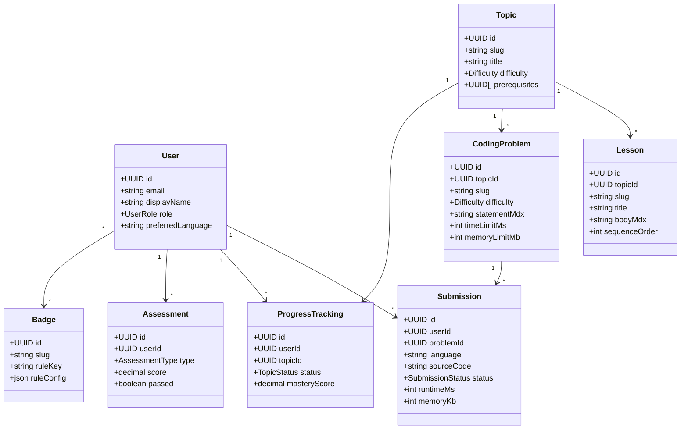
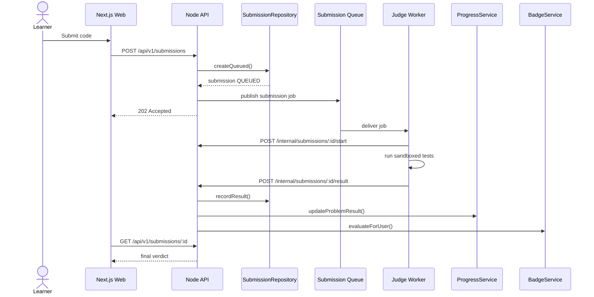

# Low-Level Design

## 1. Domain model class diagram



## 2. Service layer design

| Service | Public methods | Key dependencies |
| --- | --- | --- |
| `AuthService` | `register`, `login`, `refresh`, `logout`, `getCurrentUser` | `UserRepository`, auth provider, token signer |
| `CurriculumService` | `listTopics`, `getTopic`, `getLesson`, `completeLesson` | `TopicRepository`, `LessonRepository`, `ProgressService` |
| `ProblemService` | `listProblems`, `getProblem`, `getHints`, `getStarterCode` | `ProblemRepository`, `ProgressRepository` |
| `SubmissionService` | `runSamples`, `createSubmission`, `getSubmission`, `recordJudgeResult` | `SubmissionRepository`, queue, `ProgressService`, `BadgeService` |
| `ProgressService` | `getRoadmap`, `updateLessonCompletion`, `updateProblemResult`, `recommendNext` | `ProgressRepository`, `AssessmentRepository` |
| `AssessmentService` | `startAssessment`, `submitAssessment`, `scoreQuiz`, `getResults` | `AssessmentRepository`, `ProgressService` |
| `BadgeService` | `evaluateForUser`, `awardBadge`, `listUserBadges` | `BadgeRepository`, `ProgressRepository` |
| `AiTutorService` | `sendMessage`, `getHint`, `reviewSubmission`, `createReviewPlan` | retrieval, LLM provider, usage limiter |
| `AnalyticsService` | `getLearnerAnalytics`, `getAdminOverview`, `getLeaderboard` | analytics repositories, aggregate tables |

## 3. Repository pattern

Repositories isolate SQL from business logic. Services own validation, authorization-sensitive decisions, and orchestration.

### Base repository interface

```ts
export interface Repository<TRecord, TId = string> {
  findById(id: TId): Promise<TRecord | null>;
  create(input: unknown): Promise<TRecord>;
  update(id: TId, input: unknown): Promise<TRecord>;
  delete(id: TId): Promise<void>;
}
```

### Topic repository

```ts
export interface TopicRepository {
  listPublished(): Promise<Topic[]>;
  findBySlug(slug: string): Promise<Topic | null>;
  findPrerequisites(topicId: string): Promise<Topic[]>;
  create(input: CreateTopicInput): Promise<Topic>;
  update(topicId: string, input: UpdateTopicInput): Promise<Topic>;
}
```

### Lesson repository

```ts
export interface LessonRepository {
  listByTopic(topicId: string): Promise<Lesson[]>;
  findBySlug(slug: string): Promise<Lesson | null>;
  markCompleted(userId: string, lessonId: string): Promise<void>;
  countCompletedByTopic(userId: string, topicId: string): Promise<number>;
}
```

### Submission repository

```ts
export interface SubmissionRepository {
  createQueued(input: CreateSubmissionInput): Promise<Submission>;
  findVisibleToUser(submissionId: string, userId: string): Promise<Submission | null>;
  markRunning(submissionId: string): Promise<Submission>;
  recordResult(submissionId: string, result: JudgeResult): Promise<Submission>;
  listForUser(userId: string, filters: SubmissionFilters): Promise<Paginated<Submission>>;
}
```

## 4. Submission sequence



## 5. Service rules

### CurriculumService

- Only published topics/lessons are visible to learners.
- Admin preview can include drafts.
- Lesson completion is idempotent.
- Completing a lesson may unlock dependent topics.

### SubmissionService

- Reject unsupported language/problem combinations.
- Reject submissions for unpublished problems.
- Enforce rate limits before queueing.
- Use idempotency key to avoid duplicate client retries.
- Only judge workers can call internal result endpoints.

### ProgressService

- Recompute mastery after lesson, quiz, assessment, and accepted submission events.
- Keep progress updates transactional with the triggering event where practical.
- Apply score decay for inactivity only in scheduled jobs, not normal reads.

### AiTutorService

- Retrieve relevant lesson/problem context before calling the model.
- Enforce progressive hint levels.
- Never include hidden tests in prompts.
- Persist token usage and safety metadata.

## 6. Dependency direction

```text
routes/controllers
  -> services
    -> repositories
      -> database

services
  -> queues/providers
  -> other services through explicit interfaces only
```

Routes should not contain SQL or business logic. Repositories should not contain authorization decisions. Workers should use internal APIs or narrowly scoped repositories, not frontend endpoints.
