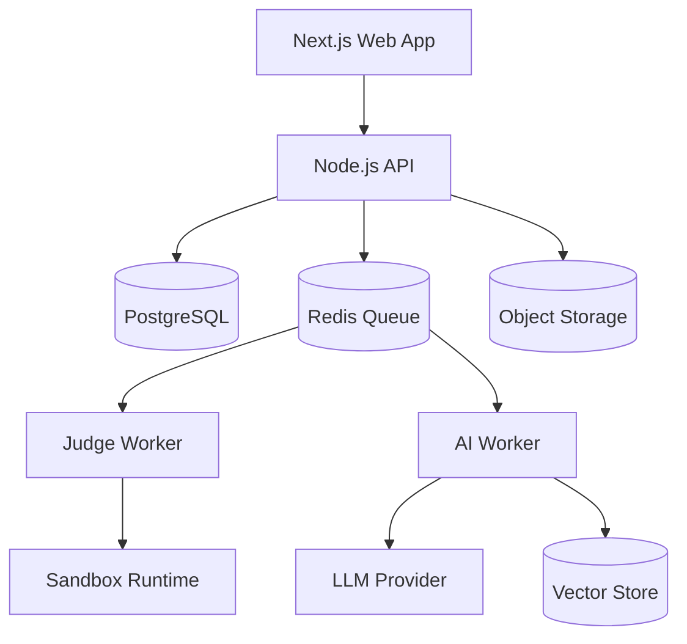

# DSA Learning Platform: Product and System Structure

Prepared for implementation teams, faculty reviewers, and technical stakeholders.

## 1. Purpose

This document summarizes the structure of a Data Structures and Algorithms learning platform. The platform teaches core CS DSA topics through lessons, simulations, coding practice, quizzes, assessments, AI tutoring, and analytics.

## 2. Curriculum Structure

The curriculum is organized as a prerequisite-based graph instead of a flat list.

| Stage | Topics | Learning outcome |
| --- | --- | --- |
| Foundations | Complexity Analysis, Arrays, Strings, Linked Lists, Stacks, Queues | Understand core data representation and Big O tradeoffs. |
| Core Tools | Recursion, Sorting, Searching, Hashing | Build problem-solving techniques used across interviews and coursework. |
| Hierarchical Structures | Trees, Heaps, Tries | Model hierarchical, priority, and prefix-based data. |
| Graph and Search Patterns | Graphs, Greedy, Backtracking, Divide and Conquer | Solve relationship, optimization, and exhaustive-search problems. |
| Advanced Optimization | Dynamic Programming and mixed-topic problems | Optimize repeated subproblems and combine patterns. |

## 3. Product Modules

| Module | Responsibility |
| --- | --- |
| Interactive Lessons | Explain concepts using text, examples, diagrams, and short quizzes. |
| Visual Simulations | Animate algorithm state changes step by step. |
| Coding Playground | Let students run and submit solutions in supported languages. |
| Judge Worker | Execute submitted code in an isolated sandbox and return verdicts. |
| AI Tutor | Provide progressive hints, explain errors, and recommend review topics. |
| Progress Tracking | Track completion, mastery, streaks, and weak areas. |
| Assessments | Measure topic and milestone readiness. |
| Badges and Leaderboard | Encourage motivation with opt-in achievement systems. |
| Admin Console | Manage topics, lessons, problems, assessments, and analytics. |

## 4. System Architecture

## 5. Frontend Structure

- **Next.js App Router** for authenticated and public pages.
- **Lesson reader** for MDX lessons, code blocks, diagrams, and quizzes.
- **Simulation components** for arrays, sorting, recursion, trees, graphs, and DP.
- **Coding playground** with Monaco or CodeMirror editor.
- **Progress dashboard** showing mastery, streaks, badges, and recommendations.
- **Admin console** for curriculum and problem management.

## 6. Backend Structure

- **Auth Service:** login, registration, token verification, roles.
- **Curriculum Service:** topics, lessons, prerequisites, lesson completion.
- **Problem Service:** problem catalog, starter code, hints, tags.
- **Submission Service:** creates submissions, queues judge jobs, stores verdicts.
- **Progress Service:** updates topic status and mastery scores.
- **Assessment Service:** scores quizzes and milestone tests.
- **Badge Service:** awards achievements from progress and submission events.
- **AI Tutor Service:** retrieval, prompt construction, model calls, safety rules.
- **Analytics Service:** learner dashboards, instructor dashboards, leaderboard snapshots.

## 7. Database Structure

Core tables:

- `users`
- `topics`
- `lessons`
- `coding_problems`
- `submissions`
- `progress_tracking`
- `assessments`
- `badges`
- `user_badges`
- `lesson_completions`
- `ai_tutor_interactions`
- `leaderboard_snapshots`

## 8. API Structure

| API group | Example endpoints |
| --- | --- |
| Authentication | `POST /api/v1/auth/register`, `POST /api/v1/auth/login`, `GET /api/v1/auth/me` |
| Lessons | `GET /api/v1/topics`, `GET /api/v1/lessons/:lessonSlug`, `POST /api/v1/lessons/:id/complete` |
| Problems | `GET /api/v1/problems`, `GET /api/v1/problems/:slug`, `GET /api/v1/problems/:id/hints` |
| Submissions | `POST /api/v1/submissions/run`, `POST /api/v1/submissions`, `GET /api/v1/submissions/:id` |
| Progress | `GET /api/v1/progress`, `GET /api/v1/progress/recommendations` |
| Analytics | `GET /api/v1/analytics/me`, `GET /api/v1/analytics/leaderboard` |

## 9. Authentication and Security

1. Student logs in with email/password or OAuth.
2. Frontend receives a short-lived access token and secure refresh session.
3. API validates the token on protected routes.
4. API checks role permissions: learner, instructor, admin, or system.
5. Judge workers use internal service credentials.
6. Submitted code executes without database access and with strict CPU, memory, output, and network limits.

## 10. Data Flow for Coding Submission

1. Student writes code in the playground.
2. Frontend sends source code, language, and problem ID to the API.
3. API creates a `QUEUED` submission row.
4. API publishes a job to Redis.
5. Judge worker executes code in sandbox.
6. Worker sends verdict, runtime, memory, and test summary back to API.
7. API updates progress and badge eligibility.
8. Student dashboard updates with new mastery data.

## 11. Recommended Technology Stack

| Layer | Recommendation |
| --- | --- |
| Frontend | Next.js, TypeScript, Tailwind CSS, shadcn/ui, TanStack Query, Monaco Editor |
| Backend | Node.js, Fastify or NestJS, TypeScript, Zod, OpenAPI |
| Database | PostgreSQL, Redis, pgvector |
| Code execution | Sandboxed Docker or microVM workers |
| Auth | Clerk, Supabase Auth, Auth0, or Auth.js |
| AI | OpenAI, Anthropic, or Azure OpenAI with retrieval over lesson content |
| Cloud | Vercel for web, managed Postgres/Redis, container workers, S3-compatible storage |

## 12. Implementation Priorities

1. Authentication and user profiles.
2. Topic and lesson catalog.
3. Progress tracking and quizzes.
4. Coding playground and judge worker.
5. AI tutor and retrieval.
6. Analytics, badges, and leaderboard.
7. Instructor/admin workflows.
